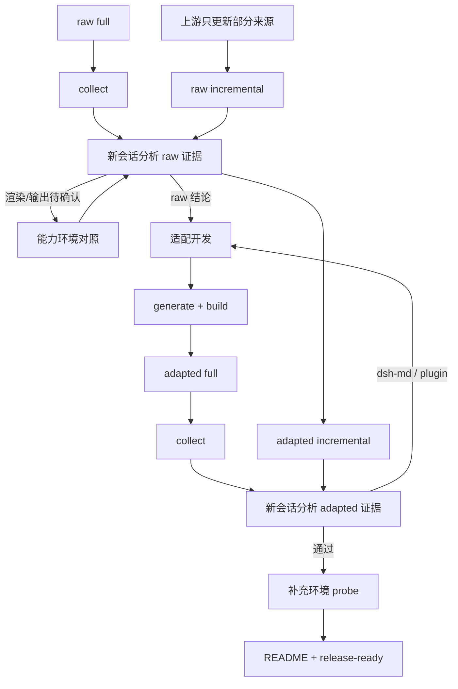

# Playground 验证流程

本文件定义 playground 的阶段、命令、批次和交接条件。所有命令在仓库根执行，playground worker 运行时支持 Linux 与 macOS。

## 阶段模型

- 每个 `phase/environment` 只保留一份当前完整快照：`reviews/<phase>-<environment>/`。
- `manifest.json` 记录最后批次、mode、覆盖场景，以及每个场景记录中的环境元数据（含上游 revision 和 port 版本）。
- `index.md` 是分析问答，也是后续修改 dsh.md 和适配实现的决策源。
- `reviews/<phase>-<environment>/scenarios/**` 保存每个场景的 `record.json`、`screenshot.png`；`session.jsonl.zstd` 只保留本地，不提交。
- `reviews/.staging/` 是批次运行中的临时目录，不提交。

## 批次

- `run-batch --full`：覆盖当前 phase/environment 的全部适用场景，成功后整份当前快照更新。
- `run-batch --scenarios`：增量批次，只替换本次跑到的场景；未跑到的场景保留当前快照。
- `run-batch --only-failed`：raw 只选择 gap，adapted 只选择 not-verified。
- `batchId` 在批次启动时生成，不按记录时间推导；它只写入 `current-batch.json` 和 `manifest.json`。
- 同一 phase/environment 只允许一个批次写入；批次失败时 `.staging` 丢弃，当前快照不动。

## 闭环总览



## 阶段交接

| 阶段 | 进入条件 | 产物 | 出口 |
| --- | --- | --- | --- |
| 1. raw 基线 | 无当前 raw 快照 | `reviews/raw-base/manifest.json`、`reviews/raw-base/scenarios/**` | 新会话分析 `reviews/raw-base/index.md` |
| 2. raw 分析 | raw 快照完整 | `reviews/raw-base/index.md` 的问答和 dsh.md 审查 | `dsh-md` 回适配开发；`upstream` / `ignore-environment` / `待你判断` 分别分流 |
| 3. 适配开发 | 分析给出当前阶段的 `dsh-md` 或 `plugin` | 更新当前阶段对应的 dsh.md、适配代码、生成树和 build | adapted/base |
| 4. adapted/base | 新 build 完成 | `reviews/adapted-base/` 当前快照 | 新会话分析 `reviews/adapted-base/index.md` |
| 5. adapted 分析 | adapted 快照完整 | `reviews/adapted-base/index.md` 和当前阶段 dsh.md 审查 | 通过后进 README/release-ready；用户明确指定补充环境时再跑补充环境 probe |
| 6. 补充环境 probe | adapted/base 通过且用户明确指定补充环境 | `reviews/adapted-<supplemental-environment>/` 当前快照 | 补充环境分析 |
| 7. 补充环境分析 | 补充环境快照完整 | `reviews/adapted-<supplemental-environment>/index.md` | 通过后进 README/release-ready |
| 8. README + release-ready | 前面分析通过 | README/兼容表、`vp run ci` 通过 | 用户手动 `vp run release` |

## 命令

### raw

```sh
vp run playground:raw-generate
vp run playground:prepare -- --phase raw --environment base --reset
vp run playground:bootstrap -- --phase raw --environment base --all
vp run playground:run-batch -- --phase raw --environment base --full
vp run playground:collect -- --phase raw --environment base
```

然后在新的分析会话按 [evidence-analysis.md](./evidence-analysis.md) 填写 `reviews/raw-base/index.md`。

### adapted/base

```sh
vp run playground:prepare -- --phase adapted --environment base --reset
vp run playground:bootstrap -- --phase adapted --environment base --all
vp run playground:run-batch -- --phase adapted --environment base --full
vp run playground:collect -- --phase adapted --environment base
```

### render 对照 probe

render 环境只用于同题能力对照；`render/` 下的 probe 是对应 `capabilities/` base 场景的 re-export，只覆盖环境字段，任务和观察保持一致。

```sh
vp run playground:prepare -- --phase raw --environment render --reset
vp run playground:bootstrap -- --phase raw --environment render --all
vp run playground:run-batch -- --phase raw --environment render --full
vp run playground:collect -- --phase raw --environment render
```

同时保留 `raw/base` 的同题结果，才能判断差异来自环境依赖还是 base。

### 补充环境 probe

只在用户明确指定特殊环境时运行：

```sh
vp run playground:prepare -- --phase adapted --environment <supplemental-environment> --reset
vp run playground:run-batch -- --phase adapted --environment <supplemental-environment> --full
vp run playground:collect -- --phase adapted --environment <supplemental-environment>
```

### 增量与上游更新

上游更新只影响部分来源时，先用 diff 把改动映射到能力和场景，再跑对应增量：

```sh
vp run playground:run-batch -- --phase raw --environment base --scenarios <changed-scenario-a>,<changed-scenario-b>
vp run playground:collect -- --phase raw --environment base
```

完成 port 修改后，用同一批场景跑 adapted 增量：

```sh
vp run playground:run-batch -- --phase adapted --environment base --scenarios <changed-scenario-a>,<changed-scenario-b>
vp run playground:collect -- --phase adapted --environment base
```

增量批次只替换本次跑到的场景；当前快照里其他场景保持不变。需要吸收增量、建立新基线时再跑一次 `--full`。

## 分析分流

每个问题只能落到以下一种结论。这里的“类型”是后续动作分流，不是能力类别；能力类别见 [evidence-analysis.md](./evidence-analysis.md)。

- `dsh-md`：改当前阶段对应的 dsh.md；raw 改 `playground/raw/dsh.md`，adapted 改 `port/dsh.md`，必要时同步 `dsh.zh.md`。
- `plugin`：改插件、工具或预设，build 后跑受影响场景。
- `upstream`：记录为上游问题，不在本仓修。
- `ignore-environment`：记录环境权限、凭据、网络或无头限制。
- `待你判断`：证据不足或分类会影响方案，交用户决定。

raw 分析只对照 `playground/raw/dsh.md`，adapted 分析只对照 `port/dsh.md`。具体按能力类别的分析维度和 finding 格式见 [evidence-analysis.md](./evidence-analysis.md)，结论必须由证据和根因支撑，不能把单一观察直接等同于适配说明缺陷。

## dsh.md

- `playground/raw/dsh.md` 是 raw 基准答案，`port/dsh.md` 是最终随包答案，两者不能合并。
- 分析只提出适配说明的修改建议；实际修改由人确认后写入。
- dsh.md 只描述 DSH 能力，不写具体插件、包、外部二进制或服务的安装建议；可选能力用能力类别说明。
- 本地化版 `dsh.zh.md` 是逐行翻译，只供审阅，生成器不读；其他 locale 按同一规则扩展。
- `playground/raw/dsh-evidence.md` 保存判定依据。

## 发版

更新根 `README.md`、`README.zh.md`、`port/AGENTS.md`、`docs/architecture.md`，然后：

```sh
vp run compatibility:check
vp run ci
```

agent 停在 release-ready。`vp run release` 由用户手动执行。
